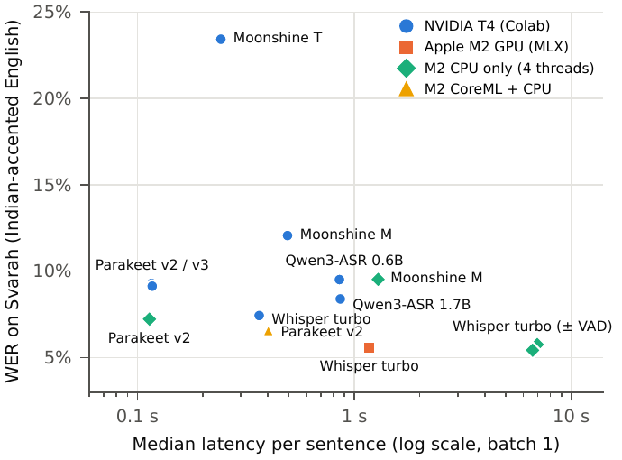
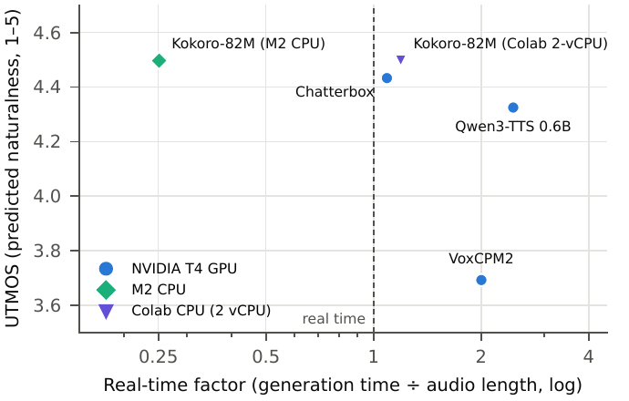
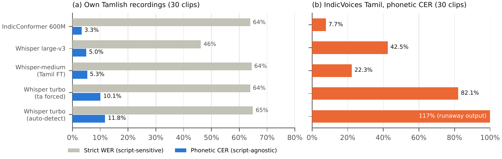

# Local Voice Models for English and Tamlish

**An evidence-based comparison of open speech models that run on your own hardware, and a fine-tuning plan for Tamil–English code-mixed speech.**

[-2a78d6)](paper/main.pdf)
[](https://colab.research.google.com/github/Kiranrossi/local-voice-research/blob/main/notebooks/01_stt_colab.ipynb)
[](https://colab.research.google.com/github/Kiranrossi/local-voice-research/blob/main/notebooks/02_tts_colab.ipynb)
[](https://colab.research.google.com/github/Kiranrossi/local-voice-research/blob/main/notebooks/03_tamlish_colab.ipynb)

We tested **7 speech-to-text (STT)** and **4 text-to-speech (TTS)** models on three real machines (NVIDIA T4 GPU, MacBook Air M2 GPU, M2 CPU-only) against Indian-accented English and our own recordings, then tested **5 setups** on spoken Tamlish. Every number in the paper comes from the raw outputs committed here.

---

## Recommendations

| Setting | Best | Fallback |
|---|---|---|
| **STT, NVIDIA GPU** (T4 / RTX 4090) | Whisper large-v3-turbo + Silero VAD — most accurate on Indian English (7.4% WER), 22/26 entities | Parakeet-TDT-0.6B-v2 — 3× faster (0.12 s), never hallucinated |
| **STT, Apple Silicon (8 GB)** | Whisper turbo via MLX — 5.6% WER, 1.2 s | Parakeet-TDT-0.6B-v2 (CoreML) |
| **STT, CPU only** | Parakeet-TDT-0.6B-v2 int8 ONNX — 7.2% WER at 0.11 s | Moonshine Streaming medium |
| **TTS, any profile** | Kokoro-82M — best UTMOS (4.50) and intelligibility; the only one faster than real time on CPU | Chatterbox (MIT) |
| **Tamlish** | No model handles it out of the box. Plan: **LoRA fine-tune of Whisper large-v3**, STT first | — |

## Key findings

1. **Leaderboard rank doesn't transfer to Indian English.** Qwen3-ASR leads the public leaderboard but trails Whisper turbo on Svarah.
2. **A voice-activity filter is required for Whisper.** Without it, Whisper wrote text on 8–10 of 10 silent clips; with Silero VAD, 0.
3. **Hardware changes speed, not accuracy.** On the same 50 Svarah clips, Whisper turbo scored 5.6–5.8% WER on the T4, the M2 GPU and the M2 CPU; only latency changed (0.4 s to 7 s).
4. **Most Tamlish "errors" are a writing convention, not mishearing.** Models hear the English words (83–95% recall) but write them in Tamil script. Script-agnostic phonetic error is only 3–12%.

<p align="center">
  
  
</p>
<p align="center">
  
</p>

Full tables: [`results/summary.md`](results/summary.md).

## Repository layout

```
paper/        IEEE paper: main.pdf, LaTeX source, figures, overleaf.zip
notebooks/    Colab notebooks: 01 STT, 02 TTS, 03 Tamlish
src/          harness.py (timing, memory, WER), tamlish.py (code-mixed metrics),
              tts_bench.py, analyze.py, run_mac*.py (Mac CPU / MLX / CoreML runners)
data/         test_sentences.md — 30 Tamlish + 10 English sentences
results/      raw outputs per run, scored CSVs, summary.md, listening-test responses
tools/        recorder.html (record test clips in the browser), listening_test/ (blind TTS test)
```

## Reproduce

**On Colab (GPU):** open a notebook from the badges above, add your Hugging Face token in the Secrets panel as `HF_TOKEN`, and run all cells.

**On a Mac:**
```bash
pip install faster-whisper mlx-whisper onnx-asr transformers jiwer soundfile scipy pandas
python src/run_mac.py --list            # STT: one model per command
python src/run_mac_tts.py kokoro-cpu    # TTS on CPU
python src/run_mac_tamlish.py --prepare # Tamlish test sets
```

**Tables and paper:**
```bash
python src/analyze.py                   # results/summary.md
python paper/collect.py && python paper/make_figures.py
cd paper && latexmk -xelatex main.tex   # on Overleaf: upload overleaf.zip, compiler = XeLaTeX
```

## Evidence and limitations

Every claim in the paper is graded **A** (independent benchmark) to **D** (our small test). Our own test sets are small (10 English and 30 Tamlish clips from one speaker; one listener in the blind TTS test), so they show direction, not precise rankings. RTX 4090 figures are estimates (T4 latency ÷ 3.1, from memory bandwidth), not measurements. Audio files and model weights are not committed.

## Data and licences

Svarah and IndicVoices are from AI4Bharat (CC-BY-4.0); LibriSpeech is CC-BY-4.0. Model licences are listed in Table II of the paper.
